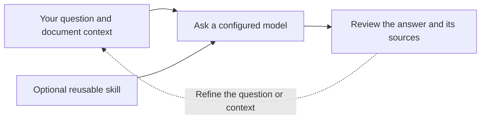

# What is LQ.AI?

## What is LQ.AI?

LQ.AI is an AI workspace for legal teams that runs on computers you control. Work with your documents, ask questions, and attach reusable instructions called skills. You choose the AI services the workspace uses and review the answers against their sources.

You need someone responsible for installation, updates, access, and backups. Start with made-up information while you check whether the setup and its workflows suit your team.

## Decide whether it fits

LQ.AI's focus is in-house legal work, including a legal team of one. The useful question is whether its current capabilities match your tasks and whether your team can operate the installation. Read the [fit assessment](is-it-for-you.md) before investing in a deployment; it includes limitations and reasons to choose another approach.

## Try a first document

The [quickstart](../quickstart.md) takes you through installation, sign-in, and uploading a fictional document. Uploading a document successfully and getting an AI answer are separate checks: asking a model or searching a knowledge base also needs the appropriate model configuration.

Use the repository's [fictional NDA](../quickstart/sample-nda.md) for the example. Keep real client material out of the first experiment. Before connecting a model, review [what information may leave the deployment](../trust/what-leaves-my-deployment.md).

## Next

- [Is LQ.AI right for your team?](is-it-for-you.md)
- [Set up LQ.AI and try your first document](../quickstart.md)
- [What information is sent outside LQ.AI?](../trust/what-leaves-my-deployment.md)
